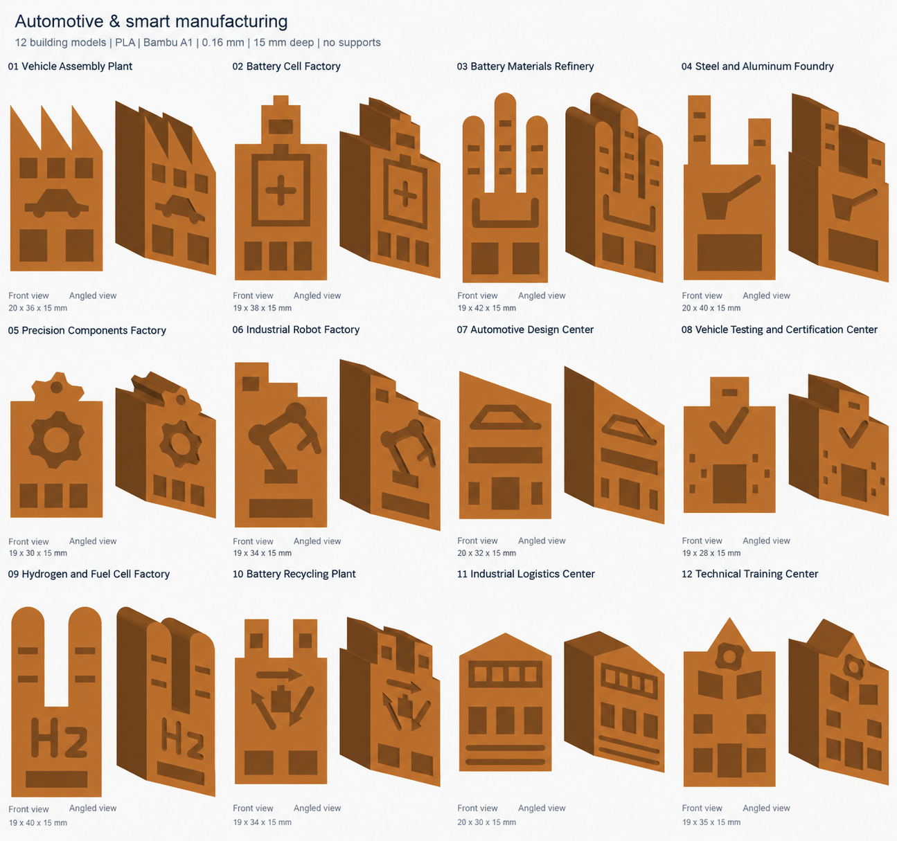

# Automotive & Smart Manufacturing: 3D-printed building miniatures

A set of 12 small building miniatures for board games, representing vehicle assembly, batteries, industrial robotics, logistics and technical training. Each piece is a single solid model with recessed facade details and a flat back for printing. The buildings can stand on their bottom edges during play.

The overview labels were edited with AI; use the STL files and dimensions below as the definitive model reference.

## Models

| No. | Building | Width × height × depth |
|---|---|---|
| 01 | Vehicle Assembly Plant | 20 × 36 × 15 mm |
| 02 | Battery Cell Factory | 19 × 38 × 15 mm |
| 03 | Battery Materials Refinery | 19 × 42 × 15 mm |
| 04 | Steel and Aluminum Foundry | 20 × 40 × 15 mm |
| 05 | Precision Components Factory | 19 × 30 × 15 mm |
| 06 | Industrial Robot Factory | 19 × 34 × 15 mm |
| 07 | Automotive Design Center | 20 × 32 × 15 mm |
| 08 | Vehicle Testing and Certification Center | 19 × 28 × 15 mm |
| 09 | Hydrogen and Fuel Cell Factory | 19 × 40 × 15 mm |
| 10 | Battery Recycling Plant | 19 × 34 × 15 mm |
| 11 | Industrial Logistics Center | 20 × 30 × 15 mm |
| 12 | Technical Training Center | 19 × 35 × 15 mm |

## Download and print

- [Individual STL files](01_Print_Models/STL/): download and slice the buildings you want.

### Bambu Lab A1 print profiles

Each profile contains all 12 automotive & smart manufacturing buildings. Nozzle diameter and layer height are separate settings.

| Profile | Nozzle diameter | Layer height | Plate layout | Printed examples |
|---|---|---|---|---|
| [Automotive & Smart Manufacturing – 0.4 mm nozzle](01_Print_Models/3MF/Automotive_Smart_Manufacturing_Bambu_A1_PLA_0.4mm_Nozzle_0.16mm_Layers.3mf) | 0.4 mm | 0.16 mm | One plate, 12 buildings | [0.4 mm photos](03_Images/Photos/README.md#04-mm-nozzle) |
| [Automotive & Smart Manufacturing – 0.2 mm nozzle](01_Print_Models/3MF/Automotive_Smart_Manufacturing_Bambu_A1_PLA_0.2mm_Nozzle_0.14mm_Layers.3mf) | 0.2 mm | 0.14 mm | Three plates, four buildings per plate | [0.2 mm photos](03_Images/Photos/0.2mm_Nozzle/) |

The [sliced Bambu A1 project](01_Print_Models/3MF/Bambu_A1_PLA_0.16mm.3mf) is also retained. It uses a 0.4 mm nozzle, 0.16 mm layers, three walls, 15% gyroid infill and no supports. Its slicer estimate is **2 hours 43 minutes** and **61.7 g of PLA** for the full plate; actual results will vary.

The 0.2 mm nozzle profile uses PLA, 0.14 mm layers, two walls, 15% gyroid infill and no supports. Open the project in Bambu Studio and slice the three plates for your printer. The recorded slicer estimates above apply to the sliced 0.4 mm nozzle project.

Units are millimetres. Place the flat back on the build plate with the detailed facade facing up. Check and adjust the settings for your own printer, filament and build plate.

## Images

- [Model covers](03_Images/Covers/): landscape 4:3 and portrait 3:4.
- [Photos by nozzle diameter](03_Images/Photos/README.md): the existing photos show the 0.4 mm nozzle prints; the new photo shows the 0.2 mm nozzle prints. Most photographs have been edited with AI to remove background distractions or adjust the composition; fine details may differ from the original photographs.
- [Streetscape renders](03_Images/Renders/): AI-generated illustrative images, not photographs of printed models.

## Source and validation

[OpenSCAD sources and manifest](02_Source_Files/) contain the editable models and their dimensions. Paths in the manifest are relative to that folder. The [print checks](04_Print_Checks/) include geometry and slicing results and printer settings. The G-code formerly stored separately is included in the Bambu Studio project.

The recorded checks report closed geometry and successful slicing of all 12 models. Inspect the models and verify settings in your slicer before printing.

## License

This project is licensed under the European Union Public Licence, version 1.2 (EUPL-1.2). See [LICENSE](LICENSE) for the full text.

[Browse buildings](../README.md) · [Back to the collection](../../README.md)
