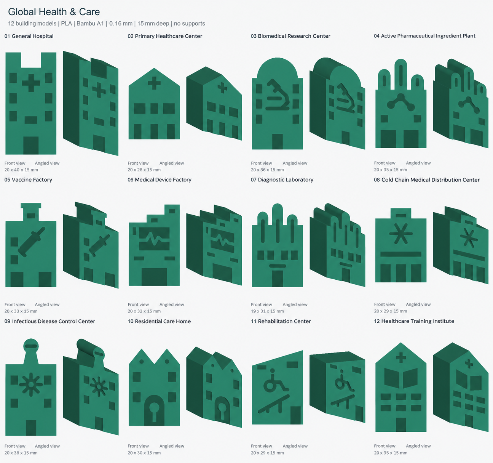

# Global Health & Care

A set of 12 small building miniatures for board games, representing hospitals, medical research, pharmaceutical manufacturing and care facilities.

## Bambu Lab A1 print profiles

| Profile | Nozzle diameter | Layer height | Plate layout | Printed examples |
|---|---|---|---|---|
| [0.4 mm nozzle](01_Print_Models/3MF/Global_Health_Care_Bambu_A1_PLA_0.4mm_Nozzle_0.16mm_Layers.3mf) | 0.4 mm | 0.16 mm | One plate, 12 buildings | [0.4 mm photos](03_Images/Photos/README.md#04-mm-nozzle) |
| [0.2 mm nozzle](01_Print_Models/3MF/Global_Health_Care_Bambu_A1_PLA_0.2mm_Nozzle_0.14mm_Layers.3mf) | 0.2 mm | 0.14 mm | Three plates, four buildings per plate | [0.2 mm photos](03_Images/Photos/0.2mm_Nozzle/) |

Print in PLA with the flat back on the build plate. The 0.2 mm nozzle profile uses two walls, 15% gyroid infill and no supports.

[STL files](01_Print_Models/STL/) · [All 3MF projects](01_Print_Models/3MF/) · [OpenSCAD sources and dimensions](02_Source_Files/) · [Print checks](04_Print_Checks/)

[Photos](03_Images/Photos/README.md) · [Covers](03_Images/Covers/) · [Streetscapes](03_Images/Renders/)

Photos and overview labels may be AI-edited; streetscapes are AI-generated illustrations.

[License: EUPL-1.2](LICENSE) · [Back to buildings](../README.md)
