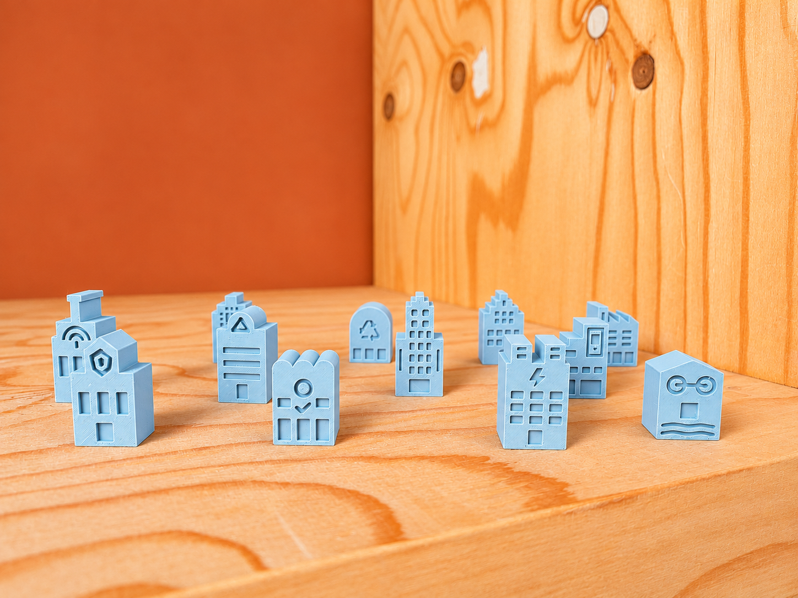

# Printed examples

## 0.4 mm nozzle

[photo_01.png](photo_01.png) · [photo_02.png](photo_02.png) · [photo_03.png](photo_03.png) · [photo_04.png](photo_04.png) · [photo_overhead.jpeg](photo_overhead.jpeg)

## 0.2 mm nozzle

[Download profile](../../01_Print_Models/3MF/Tech_AI_Digital_Bambu_A1_PLA_0.2mm_Nozzle_0.14mm_Layers.3mf) · [Compare profiles](../../README.md#bambu-lab-a1-print-profiles)

Photos may be AI-edited.
