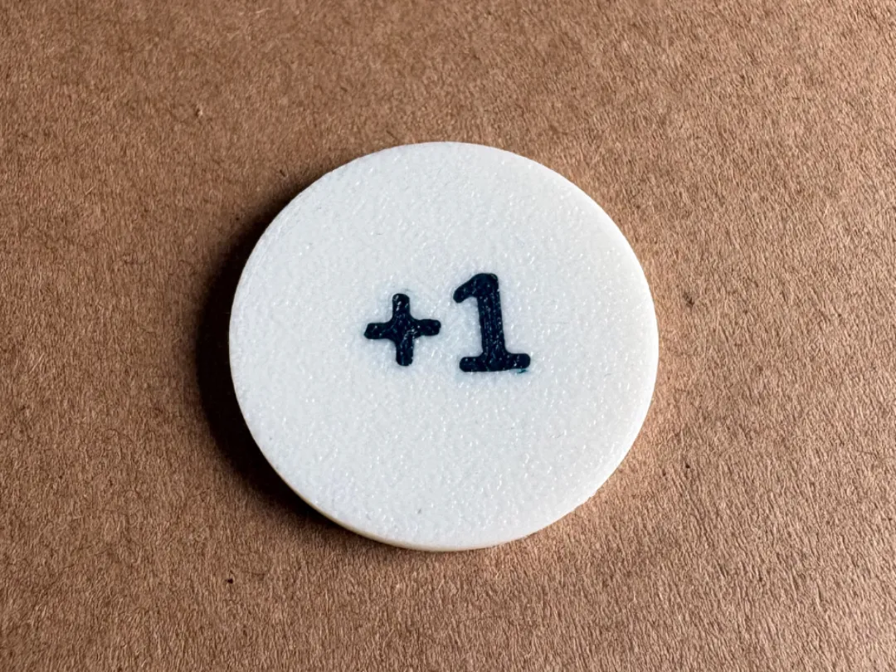

# Custom Two-Color Text Coin

A two-color coin with a flush text inlay. The included Bambu Studio project contains the **+1** coin shown below.

## Download

- [Coin.3mf](01_Print_Models/3MF/Coin.3mf) — Bambu Studio project with the coin, text and print settings.
- [coin.jpeg.webp](03_Images/coin.jpeg.webp) — photograph of the printed coin.
- [Original model on MakerWorld](https://makerworld.com/en/models/3179852-custom-two-color-text-coin#profileId-3596439) — model details and customization.

## Print settings

These settings are stored in the included 3MF project.

| Setting | Value |
|---|---|
| Printer | Bambu Lab A1 |
| Nozzle diameter | 0.4 mm |
| Layer height | 0.2 mm |
| Wall loops | 2 |
| Infill | 15% |
| Material | Two colors of PLA |
| Project colors | White coin and dark blue text |
| Supports | Disabled |
| Plates | 1 |

Open the project in Bambu Studio, confirm the printer and build plate, and assign both filament colors. Use AMS/AMS Lite or an equivalent setup for two-color printing.

The text prints face-down against the build plate and may look mirrored before the coin is removed and flipped over. The colored inlay is one layer deep, keeping the surface flat and limiting color changes. Use a clean build plate for the face of the coin.

## License

By Harm Hilvers. Licensed under Creative Commons Attribution-NonCommercial-ShareAlike 4.0 International (CC BY-NC-SA 4.0), as specified on the original MakerWorld model.

See [LICENSE.md](LICENSE.md) for the license reference and attribution.

[Browse coins](../README.md) · [Back to the collection](../../README.md)
