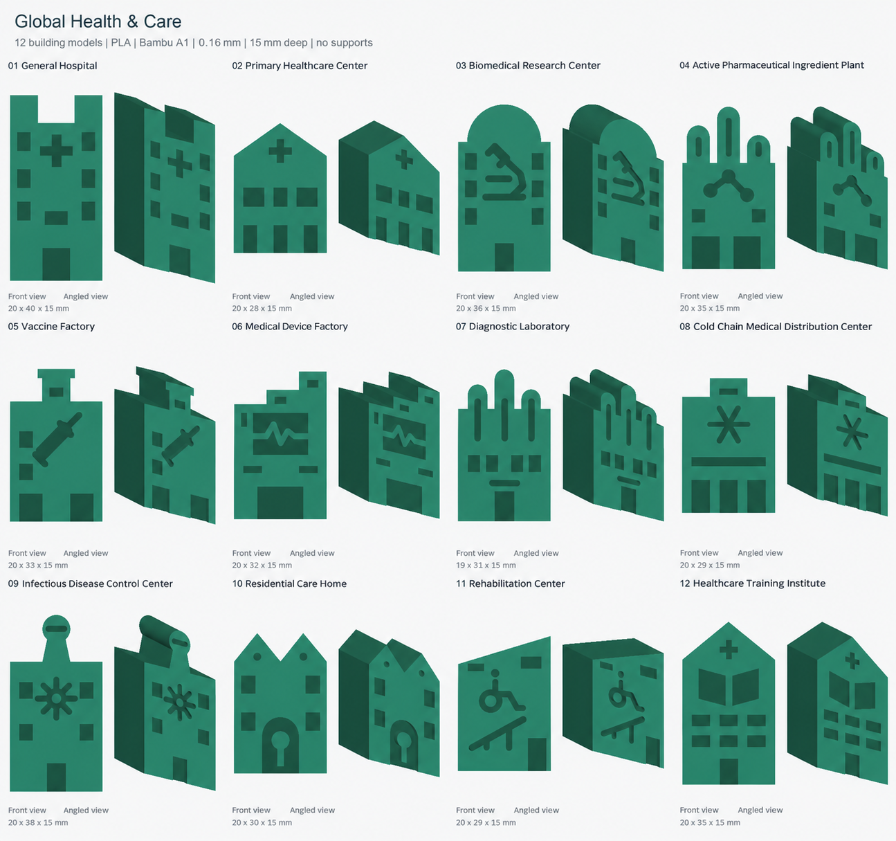

# Global Health & Care: 3D-printed building miniatures

A set of 12 small building miniatures for board games, representing hospitals, medical research, pharmaceutical manufacturing and care facilities. Each piece is a single solid model with recessed facade details and a flat back for printing. The buildings can stand on their bottom edges during play.

The overview labels were edited with AI; use the STL files and dimensions below as the definitive model reference.

## Models

| No. | Building | Width × height × depth |
|---|---|---|
| 01 | General Hospital | 20 × 40 × 15 mm |
| 02 | Primary Healthcare Center | 20 × 28 × 15 mm |
| 03 | Biomedical Research Center | 20 × 36 × 15 mm |
| 04 | Active Pharmaceutical Ingredient Plant | 20 × 35 × 15 mm |
| 05 | Vaccine Factory | 20 × 33 × 15 mm |
| 06 | Medical Device Factory | 20 × 32 × 15 mm |
| 07 | Diagnostic Laboratory | 19 × 31 × 15 mm |
| 08 | Cold Chain Medical Distribution Center | 20 × 29 × 15 mm |
| 09 | Infectious Disease Control Center | 20 × 38 × 15 mm |
| 10 | Residential Care Home | 20 × 30 × 15 mm |
| 11 | Rehabilitation Center | 20 × 29 × 15 mm |
| 12 | Healthcare Training Institute | 20 × 35 × 15 mm |

## Download and print

- [Individual STL files](01_Print_Models/STL/): download and slice the buildings you want.
- [Bambu Studio project](01_Print_Models/3MF/Bambu_A1_PLA_0.16mm.3mf): all 12 buildings on one plate, with a Bambu Lab A1 print setup.
- [Additional 3MF print profile](01_Print_Models/3MF/): the folder also contains a separate sector-specific 3MF file.

Units are millimetres. Place the flat back on the build plate with the detailed facade facing up. A suggested starting point is PLA, a 0.4 mm nozzle, 0.16 mm layers and three walls. The supplied Bambu A1 project uses 15% gyroid infill and no supports. Check and adjust the settings for your own printer, filament and build plate.

The slicer estimated **2 hours 38 minutes** and **58.5 g of PLA** for the full plate. Actual results will vary.

## Images

- [Model covers](03_Images/Covers/): landscape 4:3 and portrait 3:4.
- [Photos](03_Images/Photos/): photographs of printed models. Most have been edited with AI to remove background distractions or adjust the composition; fine details may differ from the original photographs.
- [Streetscape renders](03_Images/Renders/): AI-generated illustrative images, not photographs of printed models.

## Source and validation

[OpenSCAD sources and manifest](02_Source_Files/) contain the editable models and their dimensions. Paths in the manifest are relative to that folder. The [print checks](04_Print_Checks/) include geometry and slicing results and printer settings. The G-code formerly stored separately is included in the Bambu Studio project.

The recorded checks report closed geometry and successful slicing of all 12 models. Inspect the models and verify settings in your slicer before printing.

## License

This project is licensed under the European Union Public Licence, version 1.2 (EUPL-1.2). See [LICENSE](LICENSE) for the full text.
