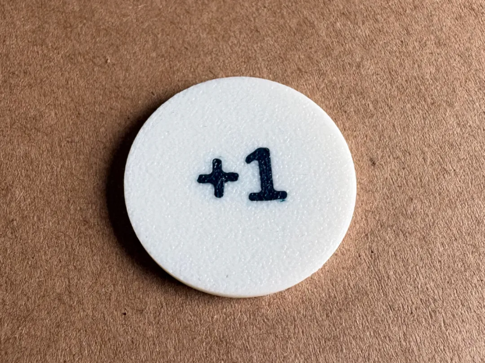

# 3D Print Collection

A collection of 3D-printable models by Harm Hilvers, organized by category. Each model or set has its own files, images and printing notes.

## Browse the collection

| Category | Models |
|---|---|
| [Buildings](Buildings/) | 36 building miniatures across three economic sectors |
| [Coins](Coins/) | A two-color text coin with a flush inlay |

### Buildings

- [Tech, AI & Digital](Buildings/Tech_AI_Digital/) — AI research, chips, digital infrastructure and cybersecurity.
- [Automotive & Smart Manufacturing](Buildings/Automotive_Smart_Manufacturing/) — vehicles, batteries, industrial robotics and logistics.
- [Global Health & Care](Buildings/Global_Health_Care/) — hospitals, medical research, pharmaceuticals and care facilities.

Each set contains 12 solid facade pieces for board games, with individual STL files, OpenSCAD sources, Bambu Studio projects, images and recorded print checks. The pieces have flat backs for printing and straight bases for standing on a game board.

The building sets include Bambu Lab A1 profiles for both 0.4 mm and 0.2 mm nozzles. The 0.2 mm nozzle profiles use 0.14 mm layers and three plates with four buildings per plate. Each set's README links to its matching profiles and photographs.

### Coins

[Custom Two-Color Text Coin](Coins/Custom_Two_Color_Text_Coin/) — a coin with a smooth, flush text inlay.

- [Download Coin.3mf](Coins/Custom_Two_Color_Text_Coin/01_Print_Models/3MF/Coin.3mf)
- [Print settings and instructions](Coins/Custom_Two_Color_Text_Coin/README.md)

## Files and printing

Files are grouped by category and model or set. Available formats vary by model; consult its README for downloads, printer settings and images. Open 3MF projects in Bambu Studio and check the printer, nozzle, filament assignments and build plate before slicing.

## Images

Most building photographs were edited with AI; the streetscapes are AI-generated illustrations. The building overview labels were also edited with AI. Refer to the model files and listed dimensions for the actual designs. Photographs of the building prints are identified by nozzle diameter in each set's documentation.

## Licenses

Licenses are specified per model or set:

- **Building miniatures:** European Union Public Licence, version 1.2 (EUPL-1.2). See the [license text](LICENSE) and the license in each building set.
- **Custom Two-Color Text Coin:** Creative Commons Attribution-NonCommercial-ShareAlike 4.0 International (CC BY-NC-SA 4.0). See the [coin license](Coins/Custom_Two_Color_Text_Coin/LICENSE.md).

The building license does not apply to the coin files.
